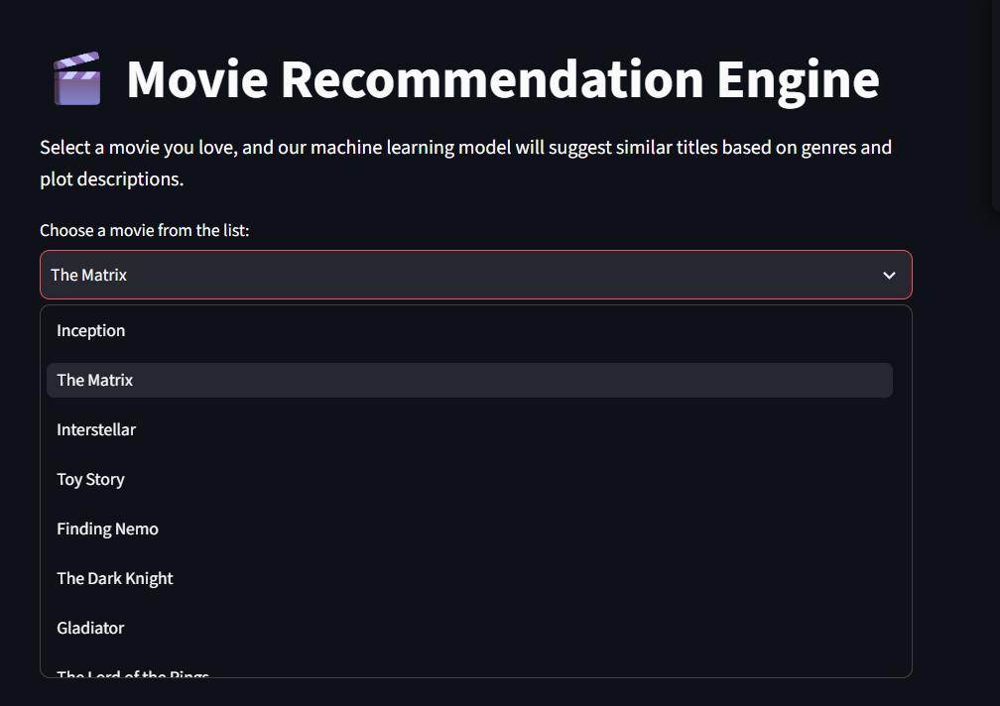
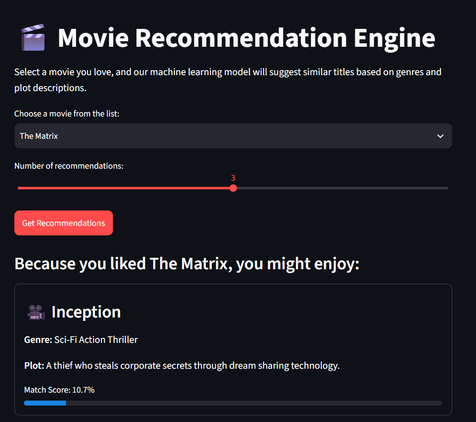
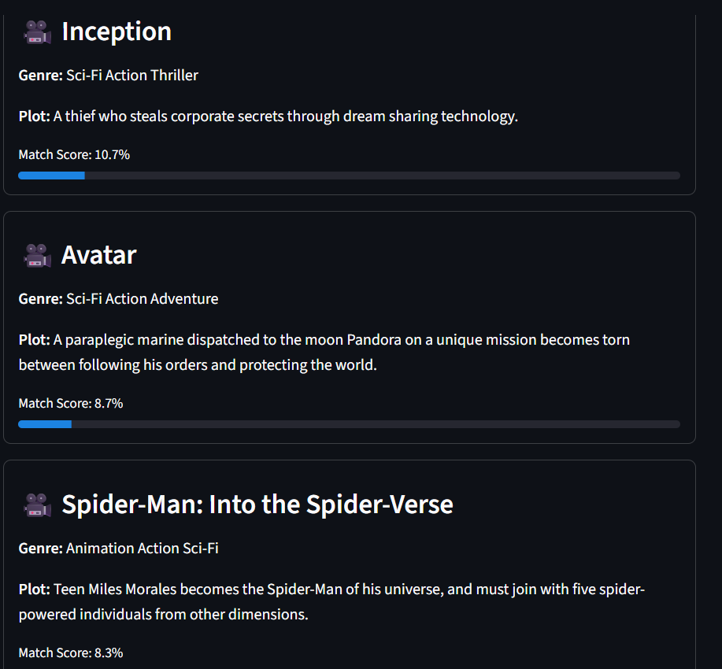

# Movie Recommendation Engine Mini Project

A Python-based **Content-Based Movie Recommendation Engine** that uses **TF-IDF Vectorization** and **Cosine Similarity** to suggest movies based on genre and plot descriptions. The interactive web UI is built with **Streamlit**.

## Screenshots







## Setup Instructions

1. **Prerequisites:** Make sure you have Python installed (Python 3.9+ recommended).

2. **Install Required Packages:**
   ```bash
   pip install -r requirements.txt
   ```

3. **Run the App:**
   ```bash
   streamlit run recommender.py
   ```
   Streamlit will open the app in your browser at `http://localhost:8501`.

## Project Features

- **Built-in Dataset:** Pre-loaded with 15 popular movies, their genres, and plot descriptions.
- **Interactive Web UI:** Choose a movie from a dropdown, pick how many recommendations you want, and click **Get Recommendations**.
- **Content-Based Filtering:** Combines genre and plot text, then ranks movies with Scikit-learn's `TfidfVectorizer` and `cosine_similarity`.
- **Match Scores:** Every suggestion shows a percentage match with a progress bar.
- **Clean Cards:** Each result displays the movie title, genre, plot summary, and match score.

## Tech Stack

- [Python](https://www.python.org/)
- [pandas](https://pandas.pydata.org/)
- [scikit-learn](https://scikit-learn.org/)
- [Streamlit](https://streamlit.io/)

## Project Structure

```
movie_-recommendation_engine/
├── recommender.py        # Streamlit app + recommendation logic
├── requirements.txt      # Python dependencies
├── screenshots/          # App screenshots used in this README
└── README.md
```
